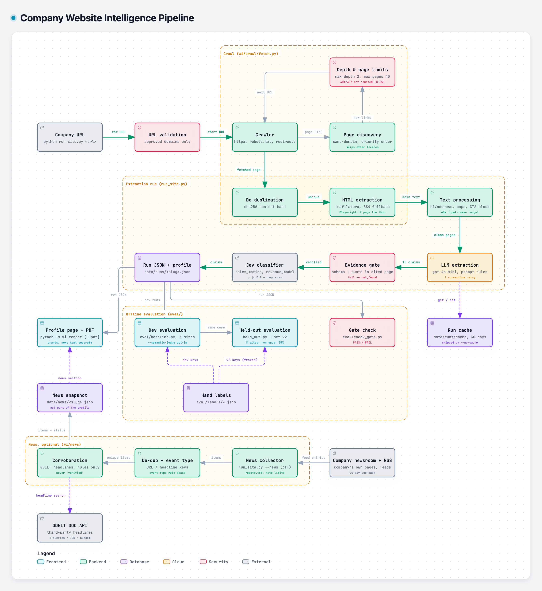

# Company Website Intelligence Prototype

Given one public company website URL, this produces a structured, evidence-backed profile of what the company states on its own website: 15 fixed fields, each with a source URL, an exact quote and a retrieval date, or an honest `not_found`.
A company website is a **self-reported source**. Claims are never presented as independently verified.



The model proposes; deterministic code disposes. Every value must quote the page it cites, or the field becomes `not_found`. Diagram source: `docs/architecture.svg`.

## Quick start

```bash
pip install -r requirements-dev.txt -r requirements-llm.txt && cp .env.example .env   # then add OPENAI_API_KEY
python run_site.py https://www.notion.com/ --news                                     # writes data/runs/notion_com.json
python -m wi.render data/runs/notion_com.json                                         # writes data/pages/notion_com.html
```

No key? `python -m wi.render samples/runs/notion_com.json` renders a saved run offline. Full setup below.

## Status at a glance

- **Accuracy is below target.** The fresh held-out set v2 (8 sites labelled by hand before any run, frozen by checksum and tag `pre-heldout-v2`, run once) scored **35%** (42 of 120 field-scores) against the PRD's **80%** (AC-02, **not met**). Of the 43 misses, 25 are the model returning `not_found` and 17 are evidence-gate rejections. Details: `eval/HELDOUT_V2_REPORT.md`.
- **Development numbers overstate it.** Current `main` scores 67–69% on the 5 dev sites it was tuned on and about 50% strict on all 13 development sites, which now include the v2 sites (`eval/DEV13_RESULTS.md`). Dev and v2 labels follow different conventions; a post-hoc category-normalised metric gives 45.8% on v2 and is secondary (`docs/SCORING.md`). 3-round means hold to ±3 points within a day; single rounds vary by up to about 8.
- **Evidence holds.** 100% of returned claims pass the evidence gate (AC-01); the gate is never loosened to raise accuracy.
- **Latency misses its p50 target; cost is well under.** p50 about 80–94 s per site against 60 s; p95 132–134 s against 180 s; mean cost about $0.006 per site against $0.10 (AC-10, `eval/latency_report*.json`).
- **What is not in `main`.** Experiments that did not beat the control were not merged: a Gemini comparison, a fallback extraction pass, price-window evidence and a gpt-4.1 extraction model (`eval/FALLBACK_EXPERIMENT.md`, `eval/DEV13_RESULTS.md`); `main` uses `gpt-4o-mini`. The optional Jev classifier (TypeSafe) is on; Abhishek approved it verbally on 2026-10-06, written confirmation pending.

Spec: `docs/PRD.MD`. Acceptance status (AC-01 to AC-12), open decisions and what was cut: `docs/ACCEPTANCE_SUMMARY.md`. Error review: `docs/ERROR_REVIEW.md`. Known limitations: `docs/KNOWN_LIMITATIONS.md`. Behaviour log: `tests/BEHAVIOURS.md`. Progress log: `PROGRESS.md`.

## Setup

Checked on Python 3.9.6 (macOS), on a fresh clone.

```bash
python3 -m venv .venv
source .venv/bin/activate
pip install -r requirements-dev.txt -r requirements-llm.txt
cp .env.example .env                         # then fill in the keys you have (names below)
```

`requirements-dev.txt` includes `requirements.txt`. `requirements-llm.txt` installs the `openai` client; it is needed for real runs **and for the tests** (9 LLM-client tests fail without it). Playwright, used only by the optional JS-page fallback, is not installed by these files (see `requirements-optional.txt`); without it the fallback is skipped.

### Starting from the handoff files

- **`company_website_intelligence_all.bundle`** (full history, every branch and tag):
  `git clone company_website_intelligence_all.bundle company_website_intelligence`, then follow the
  setup above. `HANDOFF_SHA256.txt` holds the checksums of the bundle and the zip
  (`shasum -a 256 -c HANDOFF_SHA256.txt`).
- **`company_website_intelligence_main.zip`** (the `main` branch only): it is not a git repository
  and holds no `data/` folder.
  - **Tests:** one test (`tests/test_snapshot.py::test_b88_snapshots_are_git_ignored`) asks git whether
    `data/clean/` is ignored, so outside a repository it is skipped (3 skipped instead of 2).
  - **No saved runs under `data/`:** apart from the three samples below, there are no saved runs,
    snapshots or rendered pages, so the "Evaluation" steps need runs first (which needs
    `OPENAI_API_KEY`). The `data/` folders are created on the first run.
  - **No git restore:** the `git checkout -- eval/<file>` advice for restoring overwritten reports
    does not apply until the folder is a git repository with a first commit, so copy a report before
    re-running a scorer.
- **Samples:** `samples/runs/` holds three saved runs (snowflake_com, notion_com, cashfree_com) and `samples/pages/` their rendered pages, so the offline commands work without a key: `python eval/check_gate.py samples/runs/notion_com.json`, `python -m wi.render samples/runs/notion_com.json` (writes `samples/pages/notion_com.html`). They are development runs from 2026-10-11 (Notion is a dev site, snowflake.com a peeked site, cashfree.com a v2 site run after the held-out run), not held-out results.
- **Expected warnings during setup and tests:** pip may print "lxml does not provide the extra
  'html_clean'" and pytest prints urllib3's `NotOpenSSLWarning` on macOS's LibreSSL Python. Neither
  affects the results.

### Environment variables (`.env`)

Only the names are listed here. Never commit `.env` or print its values.

| Variable | Used for | Without it |
| --- | --- | --- |
| `OPENAI_API_KEY` | Extraction (`run_site.py`) and the optional semantic judge (`--semantic-judge`) | A run whose site was crawled normally stops before extraction with exit code 1 and writes no JSON. Runs whose site is unreachable, blocked or redirected need no key (see below). Scoring falls back to no judge. |
| `JEV_API_KEY` | The optional Jev classifier | Jev skips itself; the extraction result is used unchanged, and the run JSON's `classifier` section says why. |

`.env.example` also lists `ANTHROPIC_API_KEY` and `GOOGLE_API_KEY`; nothing on `main` reads them.

## Run the tests

```bash
python -m pytest -q
```

The tests mock all crawl and model calls, and need no API key. On a fresh clone 2 tests are skipped: one needs Python 3.10+, and one needs a saved run in `data/runs/` (which git ignores).

## Run one site (needs `OPENAI_API_KEY` and network; not checked here)

```bash
python run_site.py https://www.example.com/              # uses the run cache when nothing changed
python run_site.py https://www.example.com/ --no-cache   # a fresh model call; use this for any measurement
```

This crawls the site (same domain only, robots.txt respected, at most 40 pages, depth 2, 120 s, 1 request per second; `config.yaml`), cleans each page, makes one extraction call to `gpt-4o-mini`, checks every claim's quote against the page it cites, and writes `data/runs/<domain>.json`.

Add `--news` (off by default) to also write the company's own news snapshot to `data/news/<domain>.json`; it never changes the run JSON and makes no model call (`docs/NEWS_SPIKE.md`; AC-12 partial).

**Exit codes:** 0 when a run JSON was written, including unreachable, blocked and redirected sites; 1 when the URL is rejected before any crawl (`INVALID_URL`, `RESTRICTED_PLATFORM`, also for a start URL that redirects to a restricted platform) or when `OPENAI_API_KEY` is missing for a normally crawled site. Checked here: an invalid URL and a LinkedIn URL both print `REJECTED (...)` and exit 1.

### The run JSON (`data/runs/<domain>.json`)

| Key | What it holds |
| --- | --- |
| `claims` | The evidence ledger: one claim per field, `extracted`, `inferred`, `conflicting` or `not_found` (with `coverage`: the pages actually sent to the model). |
| `profile` | The canonical profile, grouped by section, with `coverage` (pages scanned, fields populated, inferred, conflicting, plus the status and language metadata below) and `gaps_conflicts`. |
| `crawl_status` | `ok`, `unreachable`, `blocked` or `redirected`, decided by the start page. |
| `crawl_error_code` | `SITE_UNREACHABLE` (unreachable, after up to 2 retries for network errors, timeouts and 5xx); `SITE_BLOCKED` (401/403, a bot-protection or CAPTCHA page, or a 429 that outlasts a short backoff); `ROBOTS_DISALLOWED` (robots.txt disallows the start URL); `REDIRECTED_OFF_DOMAIN` (the start URL redirects to another domain). `null` when ok. |
| `crawl_status_reason`, `final_url` | A plain-language reason; `final_url` is set for `redirected`. |
| `site_language`, `site_language_source`, `non_english` | Language flag (PRD Section 9): `en`, `unknown`, a declared code such as `es`, or `non-en`. `non_english` is true only when the text clearly is not English. Flag only: extraction still runs. |
| `limit_reached` | True when the crawl hit its time budget or page cap, or the input-token budget dropped pages (`dropped_pages`). |
| `crawl` | Crawl diagnostics: every page fetched with its status, skipped robots/duplicate/locale/login links, pages refused mid-crawl (`blocked_pages`), redirects dropped (`dropped_after_redirect`), per-page language. |
| `rejected`, `schema_errors` | Claims the evidence check rejected, and why; notes from the claim checks. |
| `classifier`, `focus_retry` | Jev's decisions (or why it skipped); the focused second pass (off by default). |
| `usage`, `timing`, `cache_status` | Tokens and estimated cost, seconds per stage, whether the extraction came from the run cache. |

When `crawl_status` is not `ok`, no model is called, every field is `not_found` with 0 pages checked, and the JSON is still written (exit 0).

## Check and render a saved run (offline; checked here)

```bash
python eval/check_gate.py data/runs/<domain>.json    # schema-valid, every populated claim has evidence; exit 0 = PASS
python -m wi.render data/runs/<domain>.json          # writes data/pages/<domain>.html; no model call
python -m wi.render data/runs/<domain>.json --pdf    # writes data/pages/<domain>.pdf (needs playwright + chromium)
```

The rendered page shows each fact with its status and quote, all `not_found` fields under Gaps, and a banner when the run is partial (`limit_reached`), non-English, or `crawl_status` is not `ok` (with its code and reason).

It also shows three inline SVG charts: field coverage by status (coverage, not accuracy), the pages used as evidence with how many fields each supports, and, in the separate news section, a 90-day timeline of the news items. Printed or exported with `--pdf`, the page starts with a cover page and shows the evidence drawers open.

## Evaluation

The scripts below make no model call unless `--semantic-judge` is passed, and need the runs to exist in `data/runs/` first.

```bash
python eval/baseline.py                  # the 5 dev sites, strict scoring        (checked here)
python eval/score_one.py calendly        # one dev site                           (checked here)
python eval/latency_report.py            # p50/p95 latency, tokens, cost per site (checked here)
python eval/baseline.py --semantic-judge # adds the judge; needs OPENAI_API_KEY   (not checked here)
```

These scripts **overwrite committed report files** (`eval/baseline_report.json`, `eval/score_one_<site>_report.json`, `eval/latency_report.json`). Copy a report you want to keep to a new name, or restore with `git checkout -- eval/<file>`.

### Reproducing the dev benchmark (needs keys and network; not checked here)

1. Run each dev site fresh: `python run_site.py <url> --no-cache` for `https://calendly.com/`, `https://www.loom.com/`, `https://www.typeform.com/`, `https://www.notion.com/`, `https://simplestores.in/`.
2. Score with the judge: `python eval/baseline.py --semantic-judge`, then copy `eval/baseline_report.json` to `eval/baseline_report_<name>_nc<round>.json`.
3. `python eval/latency_report.py`, then copy `eval/latency_report.json` the same way.
4. Repeat 3 times and compare the 3-round mean with the committed reports. ±3 points holds only for 3-round means within one day; to compare two builds, run them back to back in the same window (as the `_cmp_` reports were), since the same code has moved about 2 points between days.

### Evaluation limits

- **The dev set is saturated.** Calendly, Loom, Typeform, Notion and SimpleStores were used to build and tune the pipeline, so the dev headline overstates performance on unseen sites.
- **The old 10-site held-out set is contaminated.** After it was first run and scored, fixes B-39 to B-54 were made using its failures, and B-51 re-labelled `customers.segments` in all 10 of its label files. A score on those sites is not a held-out measurement. `eval/held_out.py` exists but was not run for this README.
- **The dev labels were made by hand from the sites' screenshots and pages** (`labeling_metadata` in each `eval/labels/dev/*.json`) and may have gaps; `docs/ERROR_REVIEW.md` attributes about a third of dev errors to the labels. For example, Calendly's certifications label says `not_found` while the page lists SOC 2 and ISO/IEC 27001, so current code's answer scores as unsupported; labels are not edited to match outputs. `company_identity.description` also depends on which of several real sentences the model picks.
- **Label layout.** `eval/labels/dev/` holds the 5 dev labels (`eval/baseline.py`), `eval/labels/heldout_v1_archived/` the old contaminated 10 (`eval/held_out.py`), `eval/labels/heldout_v2/` the 8 fresh held-out labels (`eval/checksum_labels.py`), `eval/labels/templates/` the two templates and `eval/labels/archive_old_dev/` the old dev set. Files were moved there on 2026-10-09 with contents unchanged; older notes cite the flat `eval/labels/<name>.json` paths.
- **The fresh held-out set v2 has been labelled, frozen and run once.** 8 sites, labelled by hand before any run and excluding the sites in `eval/peeked_sites.txt`; labels checksummed in `eval/labels_v2.sha256`, code tagged `pre-heldout-v2`, scored with `python -m eval.held_out --set v2 --semantic-judge`. Headline **35%**, AC-02 not met; full result and diagnosis in `eval/HELDOUT_V2_REPORT.md`. The v2 sites are now development data; a further held-out measurement needs a new, blind set.

## Development history

B-72 to B-94 were motivated partly by informal spot-checks on non-dev sites: freshworks.com (B-75 to B-81) and postman.com (B-88 to B-94), which are on the peeked list (`eval/peeked_sites.txt`) and excluded from the fresh held-out set. Earlier, B-59 to B-72 were motivated partly by snowflake.com. The peeked list now holds every site that has been run (30 domains: snowflake.com, the current and old dev sets, the old held-out set, and other one-off runs such as basecamp.com, hussmann.com and darwinbox.com), and all of them are excluded from the fresh held-out set. No dev or held-out labels were edited in this period: the label files have no commits since the 2026-10-06 snapshot, the dev labels are dated 2026-09-28, and the held-out labels last changed with B-51 (2026-09-27).

## Project layout

Architecture diagram: `docs/architecture.svg` (also `docs/architecture.png`, shown at the top), generated with Archify.

| Path | Purpose |
| --- | --- |
| `run_site.py` | One URL in, one run JSON out |
| `config.yaml` | Caps, limits, model, prices, targets, Jev settings, `prompt_version` |
| `wi/crawl/` | URL validation, fetch and crawl (robots, redirects, retries, blocked/unreachable status), cleaning, run cache, language flag |
| `wi/extract/` | Prompt, model client, extraction pipeline, focused second pass |
| `wi/validate/evidence.py` | The evidence gate: quote on the cited page and value supported by it |
| `wi/classify/` | Optional Jev decisions for `pricing.sales_motion` and `pricing.revenue_model` |
| `wi/profile/`, `wi/render/` | Canonical profile; read-only reference page (no model call) |
| `wi/eval/`, `eval/` | Scoring, latency report, gate check, dev and held-out scripts, labels, saved reports |
| `tests/` | Offline tests; `tests/BEHAVIOURS.md` lists every behaviour and its test |
| `docs/` | PRD, error review, known limitations, architecture diagram |
| `tools/diagnostics/` | Read-only debugging scripts cited by code comments and `tests/BEHAVIOURS.md` (for example, print the cleaned text the model saw for a URL); not part of the pipeline |
| `data/runs/`, `data/pages/` | Run outputs and rendered pages (not committed) |

## Rules

1. Never invent missing information. Return `not_found` with coverage.
2. Every `extracted` or `inferred` claim needs a source URL, an exact quote from that page and a retrieval date; the quote is checked by code, not by the model. Never loosen the evidence gate to raise accuracy.
3. Changed logic in `wi/extract/pipeline.py` or `wi/validate/evidence.py`: bump `EXTRACTION_LOGIC_VERSION` in `wi/crawl/cache.py`. Changed prompt: bump `prompt_version` in `config.yaml`. Both invalidate the run cache.
4. Every behaviour change needs a test and a row in `tests/BEHAVIOURS.md`.
5. Use `--no-cache` for any measurement, and judge a change on 3 or more runs.
6. Do not tune on the dev set any further and never edit a label to match an output. The v2 held-out set has been run once on the tagged code (`pre-heldout-v2`) and scored 35%; the v2 sites are now development data, so any further held-out measurement needs a new, blind set labelled under one convention (see `eval/HELDOUT_V2_REPORT.md`, section 7, and `eval/FALLBACK_EXPERIMENT.md`).
7. The 15-field schema is frozen.

## License

MIT. See `LICENSE`.
